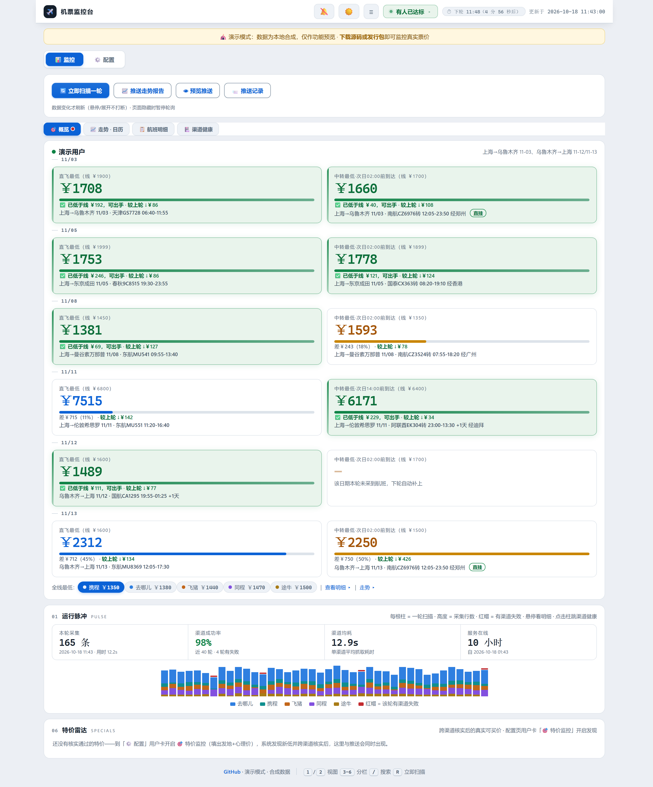
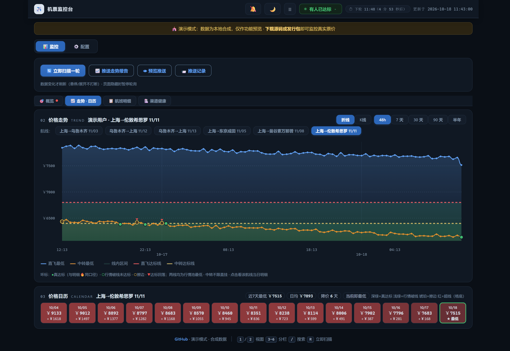
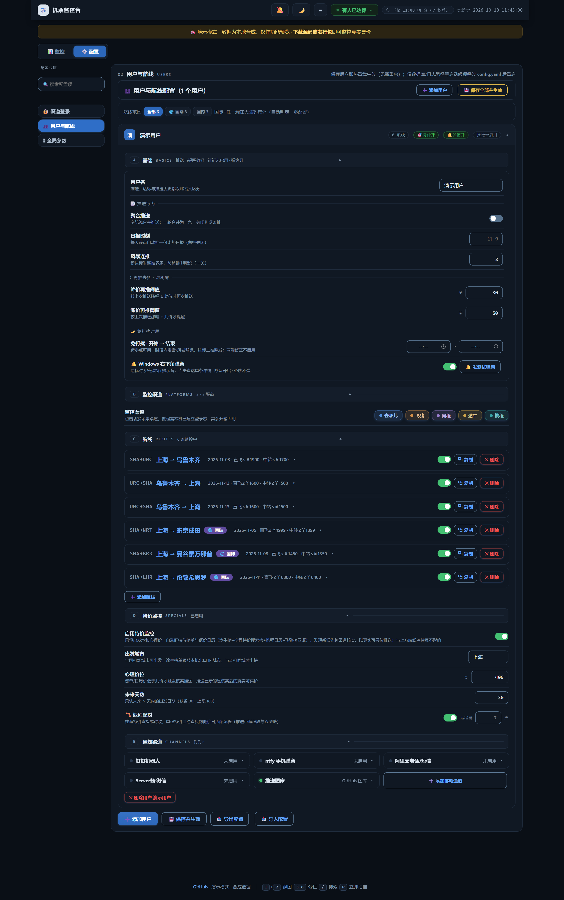
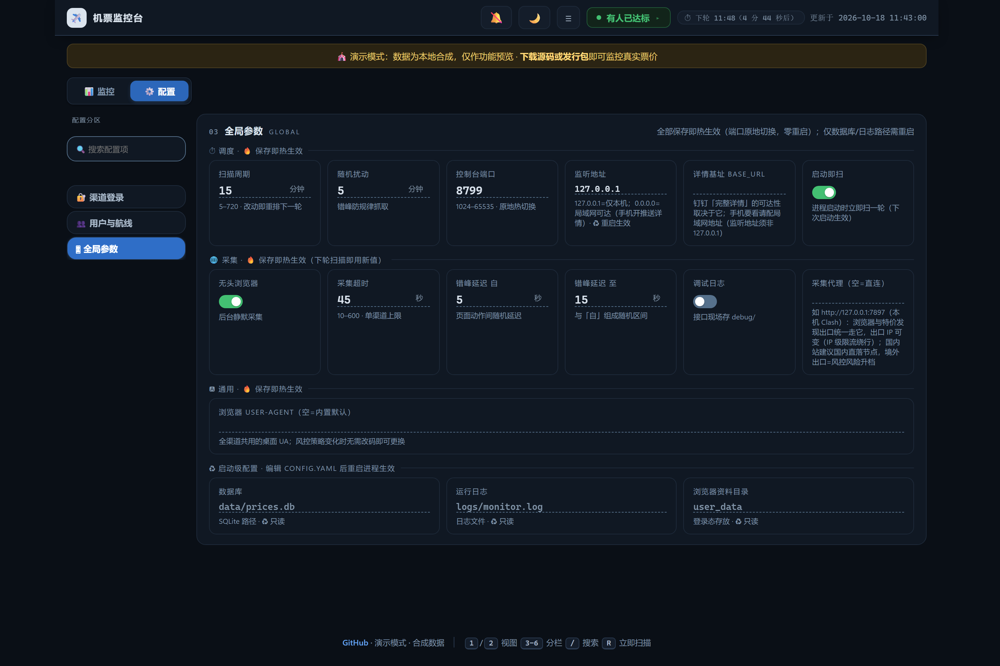
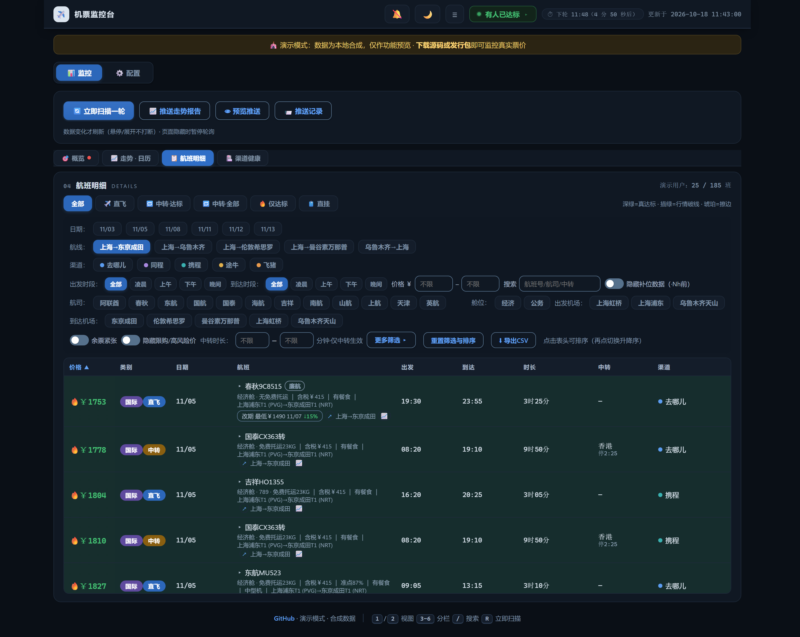
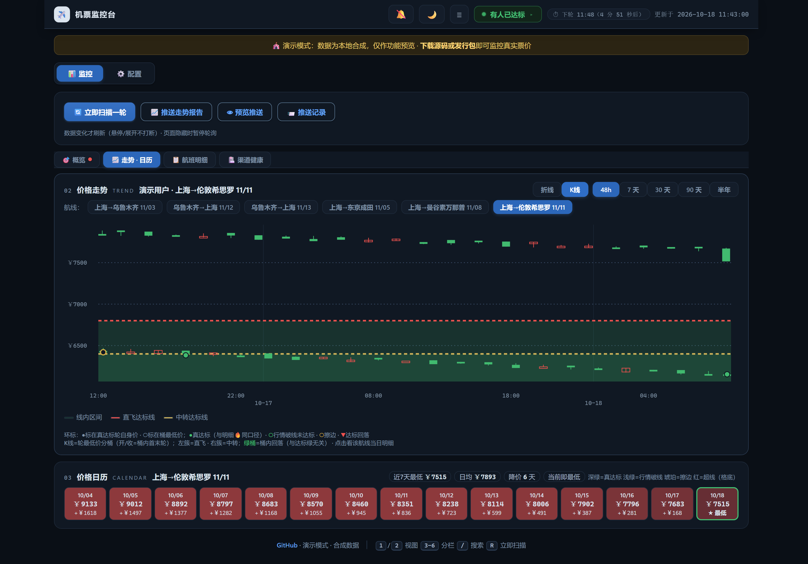
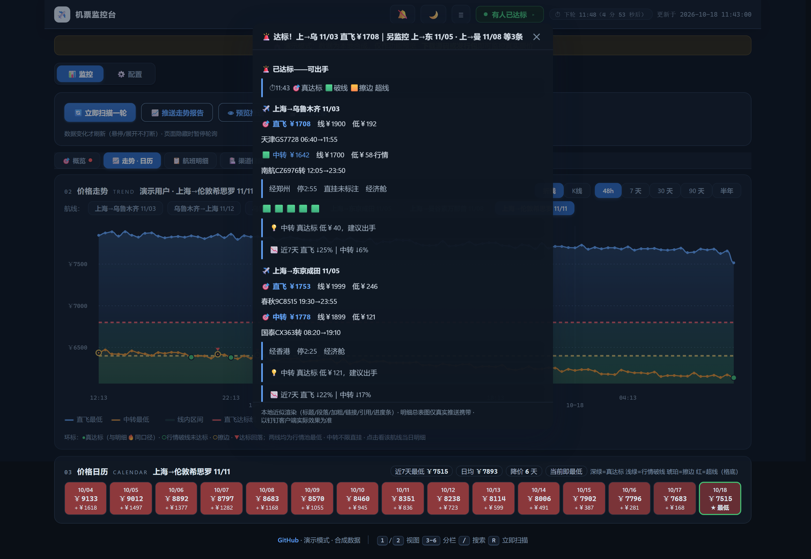
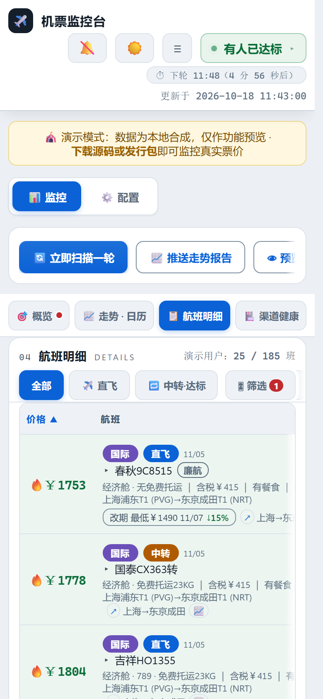

# ✈️ ticket-monitoring 机票监控

> 自托管的多渠道机票价格监控：五平台明细采集 → 钉钉图文推送 → 达标四层强提醒。
> 国内航线与国际航线（五洲目的地）同一套采集-判定-推送链路。
> 数据留在本机，配置全在网页，开源免费。

[](https://dengmeiluan.github.io/ticket-monitoring/site/)
[](https://github.com/dengmeiluan/ticket-monitoring/releases)
[](https://github.com/dengmeiluan/ticket-monitoring/actions/workflows/ci.yml)
[](https://www.python.org)
[](https://github.com/dengmeiluan/ticket-monitoring/releases)
[](LICENSE)

**[🎪 点开即玩的在线演示](https://dengmeiluan.github.io/ticket-monitoring/site/)** · [English README](README_EN.md) · [下载发行包（Windows / Linux / macOS）](https://github.com/dengmeiluan/ticket-monitoring/releases)

```
❌ 全部未达标｜最近 上→乌 09/25 直飞差￥120
├─ #### ✈️ 上海→乌鲁木齐 09/25
│    > ⏱ 16:12 🎯真达标 🟩破线 🟨擦边 超线
│    直飞 **￥2470**　线￥1900　差￥570（30%）
│    东航MU5678 12:30→17:05
│    > 经西安 停2:15 ｜ 经济舱
│    🟦🟦🟦⬜⬜
│    > 💡 直飞超线 30%，继续观望
│    > 📉 近7天 直飞 ↓8% ｜ 中转 ↓3%
│    [价格走势折线图：●深绿=真达标 ○细绿=行情破线 ○琥珀=擦边 ▼红=达标回落]
├─ #### ✈️ 乌鲁木齐→上海 10/04（17:00 后出发）
│    （第二航线起依次同构：KPI 语义三行 + 趋势 + 建议）
└─ [多航线合并明细总表：价格标绿=达标 · 同班跨渠道比价（整链不截断）]
```

> 文案全行经手机行宽估宽守卫（≤20 全角，超宽逐级降级恒保价格/航班/判据）；
> 标题全 `####` 档、语义点分档主次分明（🎯真达标 🟩破线 🟨擦边，超线为默认态
> 不占语义点）；达标明细行附「打开渠道」一键跳转。达标时：标题变 🚨、
> 群里 @你的手机号、风暴连推、（可选）ntfy 手机弹窗+铃声穿透免打扰、
> （可选）阿里云电话/短信。

## 控制台一览

飞行签派风格的控制台设计语言：数字即主角（mono 等宽）、分区编号标签、hairline 分区。
主页是**子视图工作台**（概览 / 走势·日历 / 航班明细 / 渠道健康，一屏一会话），
配置页是**面板式设置台**（左侧分区切换，同屏只显一个分区，没有长滚动）。









<details>
<summary>更多截图：航班明细 / K线 / 推送预览 / 移动端</summary>









</details>

### 键盘快捷键

| 键 | 作用 |
|---|---|
| `1` / `2` | 监控台 / 配置台 切换 |
| `3` / `4` / `5` / `6` | 直达 概览 / 走势 / 明细 / 健康 子视图 |
| `Ctrl/⌘ + S` | 配置页保存并热生效 |
| `R` | 立即扫描一轮（3 秒内再按一次确认，防手滑） |
| `/` | 聚焦明细搜索框 |
| `Esc` | 关闭弹层 / 收起同班比价展开行 |

## 特性矩阵

能力全景按「采集 → 推送 → 可视化 → 配置」四层组织，每层一张短表——
细节文档见各节与在线演示。

### 采集与监控

| 能力 | 说明 |
|---|---|
| **五渠道明细** | 去哪儿/飞猪/携程/同程/途牛统一 schema（价格/航班号/时刻/中转/跨天/时长）；**逐渠道以 PC 版为准**，直连渠道零浏览器开销；限购资格价/高风险政策价/诱饵价 ⚠ 徽标透明化，航盟归属词面随明细展示 |
| **多日期监控** | 一条航线盯多个出发日期（日期片直输 `10-08` 自动补年/📅 日历），各日期独立采集、独立推送小节、独立走势；**航线快速复制**一键克隆全部配置 |
| **航线启停** | 每条航线一个启用/停用开关：停用保留全部配置、调度/推送/明细全链路豁免——**暂停监控不再靠删除** |
| **达标判定** | 直飞/中转独立阈值；中转须满足到达约束与出发时段窗口；只认当轮实时数据 |
| **出发时段挡位** | 不限/凌晨/上午/下午/晚间五挡一点即填，也可手输精确窗口；与明细页筛选同一套挡位语义 |
| **中转衔接与直挂** | 可配**中转最短衔接分钟**（需托运建议 ≥90）与**仅认两段含免费托运的直挂班次**；不合规中转全链路豁免；推送总表衔接时长着色+「直挂」徽标 |
| **多租户** | 多用户各自航线/阈值/钉钉群；同航线去重采集、查询错峰防限流 |

### 特价与国际

| 能力 | 说明 |
|---|---|
| **特价机票监控** | 出发地+心理价两参数开启发现模式：**途牛榜+携程搜索榜+携程低价日历+飞猪榜四源发现**；榜单/日历价一律经**跨渠道核实**后以真实可买价推送（诱饵价拦截），往返成对、单程自动反向配对；概览「特价雷达」卡实时呈现 |
| **国际航班监控** | 仍只填三字码：任一端在大陆城市集外即**自动切国际端点**（五洲目的地零配置）；价格恒**含税总价**口径+税费拆分小字；跨天档放宽 0-7 天、**时区修正时长真值**；城市面板「🌐 国际」页签按地区分组 177 城/三路搜索；毒价守卫按国际量程分档 |

### 推送与提醒

| 能力 | 说明 |
|---|---|
| **聚合推送** | 多航线一轮一消息；达标小节自动置顶；**KPI 三行制**+**语义点分档**（🎯真达标 🟩破线 🟨擦边）+💡 操作建议+📉 7 天趋势；全行手机行宽估宽守卫，恒保价格/航班/判据；通道故障文末自曝 |
| **强提醒** | 钉钉 @手机号+风暴连推+**Windows 右下角弹窗（点击直达单条详情页）**+ntfy 弹窗铃声+阿里云电话短信；2h/再降￥50 去抖 |
| **免打扰时段** | 跨零点窗口（如 23:00–07:00）内省略行情心跳/风暴连推/电话短信，**达标主推与 ntfy 照发** |
| **同班比价** | 同一航班各渠道最低价并排，按「最大可省」排序 |
| **推送预览与历史** | 👁 本地近似渲染钉钉效果，改格式不等自然轮；📨 每次发送自动存档（含失败），控制台随时回看 |

### 可视化与交互

| 能力 | 说明 |
|---|---|
| **走势图** | 折线+渐变面积/**K 线双模**（涨红跌绿、OHLC 悬停）；48h/7 天/30 天/90 天/半年回看；最低点「哪天几点」标注 |
| **达标点四档环** | ●深绿真达标/○细绿破线/○琥珀擦边/▼红回落——与推送文案、明细 🔥、日历色面四方同语言 |
| **页内跳转图谱** | 点击数据点直达该轮明细（自动锁定航线与日期）；明细行 📈 与日历格点击双向闭环 |
| **价格日历** | 近 14 天逐日最低热力卡（最低日绿框「▼ 最低」，其余日 +￥差价）+**近 7 天洞察** |
| **明细表** | 筛选 19 维+行属性族（航司/机型多选、余票紧张、排除经停共享、隐藏限购高风险价、中转时长区间）/CSV 导出/每行直达下单页；行尾 📈 一键跳该航线走势 |
| **渠道健康** | 近 24h 逐轮成功/降级/失败条纹+成功率，点格子看该轮日志；推送通道同区呈现（各通道成功率/连败/最近成功） |
| **运行脉冲** | 每轮每渠道行数/耗时环形缓冲（**落盘持久化**）：4 格 mono 大数字+近 40 轮堆叠脉冲柱 |
| **子视图工作台** | 主页四子视图一屏一会话，记忆上次所在视图；切换零 DOM 插拔（翻译/比价扩展免疫） |
| **可视化对齐** | 网页走势与推送图同一信息密度；推送图浮动标签**矩形级相互避让**；推送总表圆角白卡+比价两行式行卡（整链零截断） |
| **浏览器通知** | 🔔 达标桌面通知+提示音（按价去重） |

### 配置与可靠性

| 能力 | 说明 |
|---|---|
| **面板式配置台** | 左侧分区切换（渠道登录/用户与航线/全局参数）同屏一区**告别长滚动**；设置行「说明居左控件居右」范式+分区头实时摘要 |
| **全局配置中心** | 调度/采集参数**全量热载**；启动级路径如实标注 ♻ 只读；每通道一个「测试」按钮实测 |
| **配置全热加载** | 航线/阈值/推送/周期/**端口原地切换**/无头/超时/错峰/日报时刻/图床——保存即生效**零重启** |
| **配置搜索与导入导出** | 🔍 字段级搜索；📤 导出/📥 导入 JSON（凭据本机自管）；保存前**脏改动计数**+校验；`Ctrl/⌘+S` 保存 |
| **网页登录** | 🔐 一键弹出各渠道登录窗口，点「我已登录完成」即生效，**免命令行** |
| **演示模式** | `python webui.py --demo` 零配置体验；在线演示站=静态烘焙同源页面 |
| **数据窗口** | 自动清理 14 天前明细（日粒度聚合桶另存 400 天）；走势回看 48h~半年 |
| **可靠性** | 单实例互斥锁、钉钉 -1 单发零重试、渠道失败可见、启动首轮节流；**跳转链接与爬虫主路径同源 CI 门禁**；**图挂文本兜底**（信息不随图消失） |

## 快速开始（免装 Python）

1. 到 [Releases](https://github.com/dengmeiluan/ticket-monitoring/releases) 下载对应平台包（约 69MB）：Windows `…-win64.zip` / Linux `…-linux-x64.zip` / Apple Silicon `…-macos-arm64.zip`
2. 解压到任意目录并运行：Windows `TicketMonitor.exe`；
   Linux/macOS `chmod +x TicketMonitor && ./TicketMonitor`
3. 浏览器打开 `http://127.0.0.1:8765` → ⚙️ 配置：
   - 航线（全国机场城市 + 五洲国际热门目的地：面板点选/拼音搜索/三字码直输；可配多条，每条独立阈值/日期/出发时段）
   - 直飞心理价 / 中转心理价 / 中转最晚到达时刻
   - 钉钉机器人 Webhook + 加签密钥（[创建方法](#钉钉机器人配置)），点「🔔 测试推送」即验
4. 保存即热重载生效，监控开始

> 携程渠道需要登录态：控制台「⚙️ 配置 → 🔐 渠道登录」一键弹窗登录保存（或启动命令加 `--login ctrip`）；其余四渠道开箱即用。

## 特价机票监控

不想盯死航线？特价监控只填**出发城市 + 心理价位**两个参数，自动发现全网特价：

- **四源发现**：途牛特价机票榜（免登录直连，往返特价直接成对下发）+ 携程特价搜
  索榜（出发地可控，一次请求覆盖全国多目的地低价）+ 携程低价日历（内置 44 个热
  门目的地逐城轮询，单程特价自动查反向日历配对返程）+ 飞猪特价航班榜（PC 面
  免签名接口，18 条/请求价格升序）
- **跨渠道核实**：榜单/日历价不做数——发现新低后自动用现役渠道爬虫核实该航线当日
  最低可买价，**推送的一律是核实后的真实价格**（诱饵价/裸价口径差自动拦截）
- **直达深链**：每条特价附官方购买链接（往返带双日期深链），钉钉/邮件/弹窗全通道直达
- **防刷屏**：同一特价只推一次，降价 ≥ 阈值才再推；每轮最多核实 3 条，免打扰时段顺延

配置页 ⚙️ → 用户卡 →「🎯 特价监控」填三项保存即生效；config.yaml 等价写法：

```yaml
users:
- name: 你的名字
  specials:
  - from: SHA
    from_name: 上海
    max_price: 400        # 心理价位
    days: 30              # 只认未来 30 天内出发
```

> 途牛榜单的出发地跟随本机出口 IP 城市（接口限制），与本机同城才出榜；携程低价日历的
> 出发地可任意指定。两者互补：常驻城市看途牛榜，任意出发地看携程日历。
>
> 支持可配置**采集代理**（`crawler.proxy`，如本机 Clash `http://127.0.0.1:7897`）：
> 全渠道浏览器与特价发现层的出口统一走它，出口 IP 可变（IP 级限流绕行，配置页
> 🌐 采集卡可填，保存热生效）；途牛榜城市随出口 IP 变化。注意：常见的「规则分流」
> 代理会把国内站点直连（出口不变），对国内机票端点零增益——需代理绕限流时请选
> 国内直落节点或负载均衡组，境外出口会抬高风控风险。

## 国际航班监控

想盯东京/曼谷/伦敦？国际航线**零额外配置**：三字码照填（SHA→NRT），
任一端在大陆城市集外即**自动切国际端点**——五洲目的地直接开盯：

- **五渠道国际采集**：去哪儿/飞猪/携程/同程/途牛各走国际面（国际列表页/
  含税日历），达标判定/聚合推送/明细链路零特判，同航线国内国际混排监控
- **税费透明**：国际行价格恒**含税总价**口径（跨渠道比价永不混口径），
  税费拆分小字随明细展示（「含税￥415」），推送达标行标「含税」；
  飞猪裸价税垫对国际行自动豁免
- **时区校正**：起降时刻是双端本地钟面——时长真值 = 朴素差 − 时区差
  （SHA→NRT 钟面 02:20→06:20 读 4 小时，真飞 3 小时）；跨天档放宽 0-7 天，
  长衔接国际行程不再误杀；中转最晚到达按「到达当地时刻」判
- **城市面板**：「🌐 国际」页签按地区分组（港澳台→日韩→东南亚→南亚→
  中东→欧洲→美洲→大洋洲→非洲）177 城点选，中文名/拼音/三字码三路搜索
  （"dongjing"/"成田"/NRT 皆可达东京成田），航线行头自动「🌐 国际」紫标
- **毒价守卫分档**：国际价格量程独立上界，长途经济舱全档+高档舱低价窗
  照常入池，页面污染价照拦

配置零新增字段：航线卡照填城市对即可；`config.yaml` 等价写法与国内完全
同形（from/to 填国际三字码即国际航线）。

## 从源码运行

```bash
git clone https://github.com/dengmeiluan/ticket-monitoring.git
cd ticket-monitoring
pip install -r requirements.txt
playwright install chromium
python main.py            # 无 config.yaml 时生成空骨架并引导网页配置
```

本地控制台同样在 `http://127.0.0.1:8765`；偏好命令行问答式配置可跑中文向导 `python main.py --setup`；零配置体验演示数据：`python webui.py --demo`。

## 架构

```
main.py            编排：航线去重 → 渠道线程池并发采集 → 多用户聚合分发 → 四层强提醒
crawlers/          五渠道：qunar(PC接口主路径+H5/DOM兜底) / ctrip / tongcheng(XHR拦截)
                   / fliggy(PC SSR直读) / tuniu(httpx逆向)
core/alerter.py    一轮一消息聚合推送；_digest_payload 纯构建器（控制台预览复用）
core/intl.py       国际城市字典/IANA 时区偏移/航线 scope 判定（大陆码集单源）
core/pulse.py      扫描脉冲记录器：每轮每渠道 行数/耗时 环形缓冲 → /api/pulse
core/health.py     渠道健康时间线（monitor.log 解析，维护态锁存）
core/demo.py       演示数据（真实 schema 临时库，确定性种子）
webui.py           内嵌单页控制台（纯标准库；子视图工作台+面板式配置；配置全热加载）
report.py          走势图/明细总表 PNG（Pillow）→ 图床
docs/              uitest 全功能自检 / screenshot 截图 / demo_build 静态站烘焙 / LESSONS
```

## 钉钉机器人配置

1. 钉钉群 → 群设置 → 智能群助手 → 添加机器人 → **自定义**（Webhook 接入）
2. 安全设置选 **加签**，复制密钥（SEC 开头）
3. 复制 Webhook 地址，填入配置页对应输入框，点「🔔 测试推送」验证

## 配置说明

全部配置在网页 ⚙️ 配置页完成，**保存即热生效（零重启）**：航线/阈值/出发时段、钉钉/Server酱微信/ntfy/阿里云通知/邮件（163/QQ 免费邮箱授权码，整页截图+推送图表全内嵌正文——收件端零外链加载，可配多通道与钉钉并联）、扫描周期与扰动、控制台端口（原地切换）、无头浏览器、采集超时/错峰间隔、每日日报时刻、图床。`config.yaml` 只是落盘格式；仅数据库/日志路径为启动级（见 `config.example.yaml`）。

## 常驻运行

仓库根自带三个 PowerShell 脚本：

```powershell
.\start.ps1    # 后台启动监控（PID 落 .monitor.pid，日志在 logs/）
.\status.ps1   # 查看进程/端口/最近一轮状态
.\stop.ps1     # 停止监控
```

开机自启：任务计划程序 → 创建基本任务 → 触发器选「登录时」→ 操作选启动 `start.ps1`（或 `schtasks /create /tn TicketMonitor /sc onlogon /tr "powershell -File D:\path\start.ps1"`）。

Linux/macOS 用源码常驻：`nohup python main.py >/dev/null 2>&1 &`
（systemd/launchd 按标准服务模板包一层即可）；单实例互斥锁三平台
原生（Windows msvcrt / POSIX flock），重复启动自动退出。

## 打包可执行文件

```bash
pip install pyinstaller
pyinstaller TicketMonitor.spec --noconfirm
# dist/TicketMonitor/ 即完整分发包（含 Playwright 运行时）
```

三平台同构：spec 无 Windows 专属面，Windows/Linux x64/macOS Apple
Silicon 在各自平台上执行同一条命令即得本机包（CI 矩阵
release-build.yml 即此三岗；chromium 不入包，应用首启自装内核；
Windows 右下角弹窗通道在非 Windows 自动停用，其余通道全平台可用）。
发行包三平台资产挂同一 Release，`.sha256` 校验文件随构建存档。

## 开发

```bash
PYTEST_DISABLE_PLUGIN_AUTOLOAD=1 python -m pytest tests/ -q   # 全量 2441 项：五渠道解析单测（含占位守卫/透传透镜/聚合守卫等防呆钉）+ 推送链路演练 + 链接同源门禁 + 曲线-列表一致性 + 版本门禁
python docs/uitest.py             # 全功能 UI 自检（456 断言，自动拉起演示控制台，零 JS 错硬门禁）
python docs/screenshot.py         # README 截图再生成（先起演示服：python webui.py --demo --port 8799）
python docs/demo_build.py         # 重烘在线演示站（docs/site）
```

踩坑与解法沉淀见 [docs/LESSONS.md](docs/LESSONS.md)；提交贡献前请读 [CONTRIBUTING.md](CONTRIBUTING.md)（TDD 纪律与发版流程）。安全相关问题请走 [SECURITY.md](SECURITY.md) 的私密通道。

## FAQ

**Q：页面一直开着会很耗吗？**
A：轮询带签名缓存 + ETag/304——数据没变时服务端零重算、浏览器零下载；页面隐藏自动暂停轮询，切回立即补一次。

**Q：推送报 -1「系统繁忙」？**
A：钉钉网关的"幽灵送达"——报错但消息常已入群。策略为单发零重试，丢失由下轮心跳自然补（达标场景电话通道独立兜底）。

**Q：飞猪价格为什么比别家低几十到一百？**
A：飞猪 PC 端展示的是不含税裸价，其余渠道为含税价，属数据口径差异。系统对飞猪报价 **+100 元税垫后**参与达标判定（展示价不动，推送/明细标「税前」）——所以「飞猪价低于心理线却没达标」是正常口径，不是漏报。国际行恒为含税总价口径，不涉及税垫。

**Q：想用中文问答生成第一份配置？**
A：`python main.py --setup`（发行包 `TicketMonitor.exe --setup`）。无 config.yaml 时直接启动会生成空骨架并引导到网页配置页，网页与向导二选一。

**Q：携程提示「本轮无数据渠道」？**
A：登录态过期，重跑一次 `--login ctrip` 扫码即可。

**Q：国际航线怎么配？**
A：照填三字码即可（如 SHA→NRT、SHA→LHR）。任一端在大陆城市集外即自动走
国际端点：价格恒含税总价、时长经时区校正、跨天档放宽 0-7 天，无需任何开关。

**Q：改配置要重启吗？**
A：不用。航线/阈值/通知/扫描周期/扰动/端口/无头/超时/错峰/日报时刻/图床全部保存即热生效；仅数据库/日志路径是启动级配置。

**Q：会泄露我的配置吗？**
A：凭据只存本机 `config.yaml`（gitignore 拦截）；演示模式/在线站均为合成数据，配置页不回读真实凭据。

## License

Apache-2.0（见 [LICENSE](LICENSE)）。仅供个人学习研究，请遵守各平台服务条款。

## 友情链接

- [LINUX DO 社区](https://linux.do)
