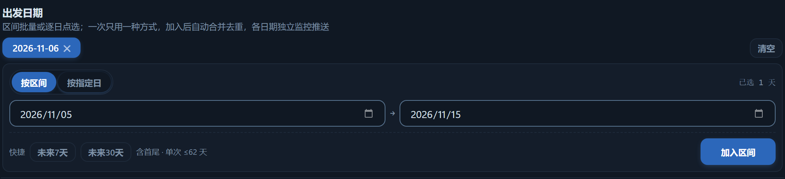
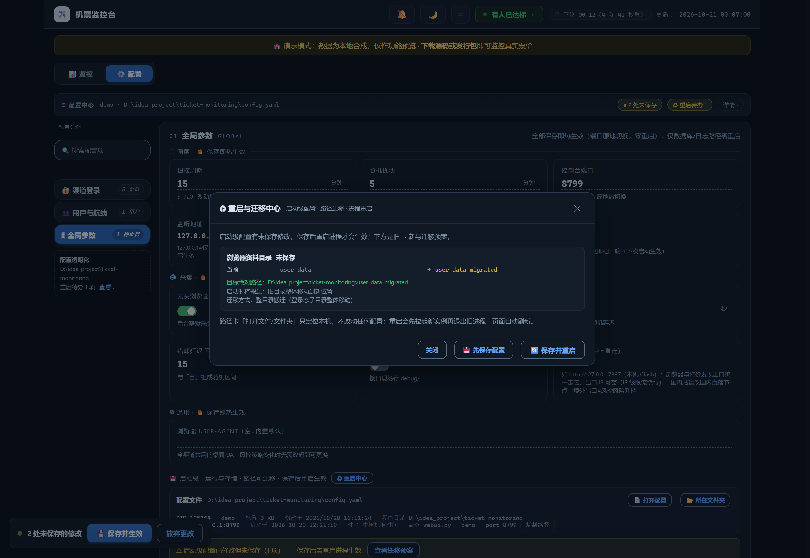
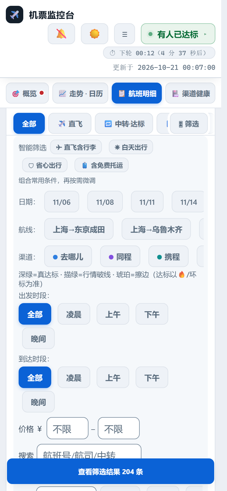

# ✈️ ticket-monitoring

> Self-hosted multi-channel flight price monitoring: 5-platform fare collection →
> rich DingTalk group reports → 4-layer urgent alerts when your target price hits.
> Domestic and international routes (destinations across five continents) run
> through the same collection → judging → push pipeline.
> For frequent flyers and small teams who want their own fare watch: fares and settings stay on your machine; outbound traffic only goes to the push channels and image host you configure.

[](https://dengmeiluan.github.io/ticket-monitoring/site/)
[](https://github.com/dengmeiluan/ticket-monitoring/releases)
[](https://github.com/dengmeiluan/ticket-monitoring/releases)
[](https://github.com/dengmeiluan/ticket-monitoring/actions/workflows/ci.yml)
[](https://www.python.org)
[](https://github.com/dengmeiluan/ticket-monitoring/releases)
[](LICENSE)

**[🎪 Live demo (zero install)](https://dengmeiluan.github.io/ticket-monitoring/site/)** · [中文文档](README.md) · [Releases (all platforms)](https://github.com/dengmeiluan/ticket-monitoring/releases)


<details>
<summary>More screenshots: panel-based settings / global config center / flight details / K-line / push preview / mobile</summary>










</details>

## What it does

- **Collects** flight details (price, flight no., times, transfers, duration, terminals, cabin, aircraft, punctuality, baggage rules) from five Chinese travel platforms: Qunar, Fliggy, Ctrip, Tongcheng, Tuniu — each on its PC-first path (Qunar PC primary with H5 fallback, Fliggy PC SSR read, Ctrip/Tongcheng/Tuniu direct HTTP), zero browser overhead except where a channel demands it.
- **Watches** your routes with per-route thresholds (direct / transfer), arrival-time constraints and departure-time windows. Each route can watch **multiple departure dates at once** through a range / specific-day mode switch — one editor at a time, both drafts retained, applied ranges merge and dedupe automatically; every date gets its own collection, push section, trend chart and calendar. **Cloning a route** copies the whole config in one click (the copy starts disabled: fix the cities, then switch on). Every route has an **enable/disable switch** — pausing keeps the whole config and exempts the route from scheduling, pushes and details everywhere; no more delete-to-stop. A **daily report** lands at your configured hour (default 09:00) with per-route KPIs and trend images.
- **Pushes** one aggregated DingTalk message per round: per-route KPI sections in a **three-tier semantic layout** (price as a direct link / flight body / decision fields in a grey quote tier) with **semantic tier dots** (🎯 hit · 🟩 below line · 🟨 near — "above line" is the default state and carries no dot), one-line action advice, 7-day trend, smoothed price charts with **four-tier hit point rings** (● dark green = truly actionable hit / ○ fine green = market broke the line / ○ amber = near / ▼ red = fell back below line) speaking the same language as the push copy, the details table and the calendar, a merged detail table image (with cross-channel price comparison for the same flight — the table image is the single carrier, nothing truncated), and per-channel jump links on hit rows. Every text line is width-guarded for phone screens (degrades gracefully, always keeping price/flight/criteria). If the table image upload ever fails, a **text fallback** carries the full TOP5 details instead (same-price multi-channel rows merge into one line with a ×N badge — information never vanishes with the picture). Email delivery (163/QQ mail boxes, full-page screenshot and push charts inline — zero external image loading on the recipient side) can run alongside DingTalk; every send is archived for in-console replay. Quiet hours (e.g. 23:00–07:00) silence routine heartbeats/storms/phone calls while hit alerts still get through.
- **Monitors international flights** with zero extra configuration: still just three-letter codes — scope is detected automatically (either end outside the mainland city set, incl. HK/MO/TW and overseas, marks the route international). International rows always carry the **tax-inclusive total price** (a small tax breakdown accompanies the detail row), cross-day tolerance widens to 0-7 days and duration truth is timezone-corrected; the city panel gains an international-hot tab (33 cities, searchable by Chinese name / pinyin / code), route heads show an automatic globe badge, hit rows are tagged tax-inclusive, and the cross-channel phantom-price guards grade by the international price range.
- **Escalates** on target hits: 🚨 title, @your phone in group, storm re-push, optional ntfy phone popup + ringtone (DND-piercing), optional **Bark push to iPhone** (self-hosted server supported), optional Aliyun phone call/SMS, Windows toast jumping to the single-alert page. Debounced (2h / further ¥50 drop). If an escalation channel itself fails, the next DingTalk push says so — an alerting system must surface its own outages.

## The console

A zero-dependency single-page console served on `127.0.0.1:8765`, designed like an airline dispatch board: monospace digits, numbered section labels, hairline dividers.

**Main view = tabbed workspace** (Overview / Trend·Calendar / Flight details / Channel health — one screen per session, remembers your last tab). The trend tab carries a **14-day price calendar** (cheapest day badged 「▼ 最低」, every other day shows a +￥ delta) plus 7-day insights. Detail rows carry an inline **📈 jump that opens that route's trend** (paired with the ↗ outbound link, anchoring route and date), and clicking any trend data point (or pressing Enter on the focused chart) opens that round's route details with the route and departure date locked — the in-page jump graph is closed both ways. **Settings = panel-based** (left rail switches between Channel login / Users & routes / Global params — one panel at a time, no endless scrolling).

Run pulse: per-round per-channel row counts & latency in a ring buffer — a 4-cell mono statline plus stacked pulse bars (red cap = some channel failed), so collection health is visible at a glance. DingTalk pushes carry a "full details" link; on Windows, target-hit toasts jump straight to the same single-alert page. Keyboard: `1`/`2` switch console/settings, `3`/`4`/`5`/`6` jump straight to Overview / Trend / Details / Health, `Ctrl/⌘+S` save settings, `R` run a sweep now (press twice to confirm), `/` focus search, `Esc` close overlays.

**Routine settings hot-reload on save; startup-level changes show a diff and require a restart**: routes, thresholds, notifiers (DingTalk / ntfy / **Bark** / Aliyun / ServerChan / email, each with a one-click test button — the Windows toast test fires a real local notification), scan interval & jitter, console port (rebound in place), headless mode, crawler timeouts & pacing, user-agent, debug dumps, daily-report hour, image host, **date quick-picks & range select / direct-flights-only toggle / round-trip multi-return dates / airline whitelist (three equivalent writings — `MU` / `China Eastern` full name / `东航` short alias, auto-normalized to the code with a live resolution preview as you type; `!` prefix = exclusion) / no-LCC / min baggage / wide-body / price ceiling / max total flight duration in hours (incl. layovers, 0.5h steps) / no-overnight / departure & arrival time windows (both support overnight wrap-around windows)**. The **Global config center** groups schedule / crawler / general with 🔥 hot badges; startup-level paths (database, log, browser profile, chromium cache) are **editable**, each showing its resolved **absolute path** with a 📂 open-folder button — old database & login-state files auto-migrate on path change. Settings also support field-level search, `Ctrl/⌘+S` save, and export/import of the whole config as JSON.

## Quick start (prebuilt, no Python needed)

1. Download your platform package from [Releases](https://github.com/dengmeiluan/ticket-monitoring/releases):
   Windows `…-win64.zip` / Linux `…-linux-x64.zip` / Apple Silicon `…-macos-arm64.zip` / Intel Mac `…-macos-x64.zip`.
2. Unzip anywhere and run it: Windows `TicketMonitor.exe`;
   Linux/macOS `chmod +x TicketMonitor && ./TicketMonitor`.
3. Open `http://127.0.0.1:8765` → ⚙️ Settings: add routes (Chinese city names with autocomplete), target prices, and your DingTalk robot Webhook + signing secret. Hit 「🔔 测试推送」 to verify.
4. Save — monitoring starts immediately.

> Ctrip requires a one-time QR-code login (`--login ctrip`); Qunar/Tongcheng/Tuniu are best after a login session, Fliggy works without one.

### Docker / NAS

```bash
cp config.example.yaml config.yaml   # first run: create config (or do it in the web UI)
docker compose up -d
```

Open `http://NAS_IP:8765`. Config, the price database (`data/`), browser sessions (`user_data/`) and logs all live in local volumes — upgrades and rebuilds keep your data. The image ships chromium and CJK fonts (~1.5 GB, no first-run browser download). The Windows toast channel auto-disables inside containers; DingTalk/email pushes are unaffected. On a NAS without Docker, grab `…-linux-x64.zip` and run it directly.

## Special fares monitoring

Don't want to pin fixed routes? The special-fares watch takes just **departure city + target price** and discovers deals on its own:

- **Quad-source discovery**: the Tuniu cheap-tickets board (login-free direct API, round-trip deals arrive pre-paired), the Ctrip special-fares search board (departure-configurable, one request covers discounted routes nationwide), the Ctrip low-price calendar (44 popular destinations polled per city; one-way deals are automatically paired with a return leg via the reverse calendar), and the Fliggy PC specials board (signature-free JSONP, 18 deals per request, price-ascending).
- **Cross-channel verification**: board/calendar prices alone never trigger a push — on a new low, the live channel crawlers verify the lowest bookable price for that route & date, and **only the verified, actually-purchasable price gets pushed** (bait prices and bare-fare mismatches are filtered out).
- **Direct booking links**: every deal carries the platform's official deep link (round trips get both dates), delivered through all push channels.
- **Spam-free**: the same deal pushes once; a further drop re-pushes; at most 3 verifications per round; quiet hours defer instead of dropping.

Configure it in the console (⚙️ → user card → 🎯 Special fares, three fields, hot-reload) or equivalently in `config.yaml`:

```yaml
users:
- name: your-name
  specials:
  - from: SHA
    from_name: Shanghai
    max_price: 400        # target price
    days: 30              # only departures within 30 days
```

> The Tuniu board's departure city follows this machine's public IP (API limitation) — it only lists deals when the IP city matches; the Ctrip calendar accepts any departure city. Together they cover both cases.
>
> An optional **collection proxy** (`crawler.proxy`, e.g. a local Clash at `http://127.0.0.1:7897`) routes every channel browser and the discovery layer through it — the egress IP becomes configurable (bypasses IP-level rate limits; the Tuniu board city follows the egress IP). Set it in the console (🌐 collection card, hot-reload). Note: rule-based proxy setups usually send domestic sites DIRECT (egress unchanged), which gains nothing for domestic endpoints — use China-direct or load-balanced groups when you actually need IP rotation; overseas exits raise anti-bot risk.

## International flights

Want to watch Tokyo, Bangkok or London? International routes need **zero extra
configuration**: still just three-letter codes (SHA→NRT). When either end sits
outside the mainland city set, the crawler **switches to the international
endpoint automatically** — destinations across five continents, ready to watch:

- **Five-channel international collection**: qunar / fliggy / ctrip /
  tongcheng / tuniu each walk their international surface (international list
  pages / tax-inclusive calendars). Judging, digest push and the detail chain
  need no special-casing — domestic and international routes can be mixed
  freely in one config
- **Tax transparency**: international prices are always the **tax-inclusive
  total** (cross-channel comparison never mixes bases); the tax breakdown
  rides along in detail rows ("incl. tax ¥415") and hit rows are tagged
  tax-inclusive; the fliggy pre-tax surcharge pad is waived for
  international rows
- **Timezone correction**: departure/arrival times are local wall clocks on
  both ends — true duration = naive difference − timezone difference
  (SHA→NRT reads 02:20→06:20, four hours on the clock, three hours in the
  air); the cross-day tolerance widens to 0-7 days so long international
  itineraries are no longer falsely rejected; latest-arrival limits judge by
  local arrival time
- **City panel**: the 🌐 international tab groups 272 destinations (33 highlighted) by region
  (Hong Kong/Macau/Taiwan → Japan/Korea → SE Asia → South Asia → Middle East →
  Europe → Americas → Oceania → Africa), searchable by Chinese name, pinyin
  or code ("dongjing", "成田" and NRT all reach Tokyo Narita); route heads
  show an automatic globe badge
- **Phantom-price guards grade by range**: international prices get their own
  upper bound — full long-haul economy range and premium-cabin low windows
  enter the pool as usual, while polluted page prices are still rejected

No new config fields: fill the city pair as usual — `from`/`to` with
international codes is all it takes.

## From source

```bash
git clone https://github.com/dengmeiluan/ticket-monitoring.git
cd ticket-monitoring
pip install -r requirements.txt
playwright install chromium
python main.py            # without config.yaml, writes an empty skeleton and guides you to the web UI
```

Prefer a Q&A wizard for the first config? `python main.py --setup` (Chinese, Enter-through defaults). Zero-config demo data: `python webui.py --demo`.

## Architecture

```
main.py            orchestration: route dedup → per-channel thread pool → multi-user aggregation → 4-layer alerts
crawlers/          five channels: qunar(PC API primary + H5/DOM fallback) / ctrip / tongcheng(XHR intercept)
                   / fliggy(PC SSR read) / tuniu(httpx reverse)
core/alerter.py    one aggregated push per round; _digest_payload pure builder (reused by console preview)
core/intl.py       international city dictionary / IANA tz offsets / route scope detection (mainland-code single source)
core/pulse.py      scan pulse recorder: per-round rows/latency ring buffer → /api/pulse
core/health.py     channel health timeline (parsed from monitor.log, maintenance latched)
core/demo.py       demo data (real-schema temp DB, deterministic seed)
webui.py           embedded single-page console (pure stdlib; workspace + panel settings; hot-reload everything)
report.py          trend chart / detail table PNG (Pillow) → image host
docs/              uitest self-test / screenshot generator / demo site baking / LESSONS
```

## DingTalk robot setup

1. In your DingTalk group: Group Settings → Bots → Add robot → **Custom** (Webhook).
2. Choose **Sign** security mode and copy the secret (starts with `SEC`).
3. Paste the Webhook URL into the settings page and hit 「🔔 测试推送」 to verify.

## Deployment (Windows)

Three PowerShell scripts live at the repo root:

```powershell
.\start.ps1    # start in background (PID in .monitor.pid, logs in logs/)
.\status.ps1   # process / port / last-round status
.\stop.ps1     # stop
```

Auto-start on login: Task Scheduler → Create Basic Task → trigger "At log on" → action runs `start.ps1`.

## Packaging

```bash
pip install pyinstaller
pyinstaller TicketMonitor.spec --noconfirm
# dist/TicketMonitor/ is the complete distributable (Playwright runtime included;
# the Chromium browser itself downloads on first launch, ~120MB)
```

## Development

Current source version: **1.5.264**. Release badges/assets may lag until the release workflow finishes.

```bash
PYTEST_DISABLE_PLUGIN_AUTOLOAD=1 python -m pytest tests/ -q   # full suite: 3164 tests — per-channel parsing units (placeholder guards / pass-through lenses / aggregation safeties) + push-pipeline dry runs + link-provenance gate + chart-vs-list consistency + version gate
python docs/uitest.py             # full UI self-test (516 assertions, self-hosted demo, zero-JS-error hard gate)
python docs/screenshot.py         # regenerate README screenshots (start the demo first: python webui.py --demo --port 8799)
python docs/demo_build.py         # rebake the static demo site (docs/site)
```

## FAQ

**Q: Does leaving the page open cost much?**
A: Polling uses a signature cache + ETag/304 — zero recomputation server-side and zero download browser-side when nothing changed; the page pauses polling when hidden and refreshes once on return.

**Q: Pushes fail with -1 "system busy"?**
A: That's DingTalk's "ghost delivery" — it errors but the message usually did land in the group. Policy is single-send, never retry; losses are naturally covered next round (phone escalation is an independent channel for hits).

**Q: Why is Fliggy sometimes cheaper by 50-100?**
A: Historically Fliggy's PC list showed tax-exclusive fares. Hit qualification now uses the **channel's original price without a tax pad**; international rows always use the **tax-inclusive total**. Any channel-side price-basis note is preserved in details and pushes for verification.

**Q: Ctrip shows "no data this round"?**
A: Login expired — run `--login ctrip` once and re-scan the QR code.

**Q: Do I need to restart after changing settings?**
A: For routine settings, no. Routes/thresholds/notifiers/interval/jitter/port/headless/timeouts/pacing/report hour/image host hot-reload on save. **Startup-level items** (database, log, browser profile, chromium cache, listen address, run-on-start) need a restart: saving shows a diff and a one-click 🔄 restart (spawns the new instance before exiting the old one; the page recovers automatically).

**Q: Will my credentials leak?**
A: Fares and settings live only on your machine (`config.yaml` / `data/`, both git-ignored). Outbound traffic only reaches the push channels and image host you configure. Demo mode and the online demo use synthetic data and never read back real credentials.

Hard-earned lessons (anti-bot, DingTalk quirks, engineering pitfalls): [docs/LESSONS.md](docs/LESSONS.md). Before filing PRs, read [CONTRIBUTING.md](CONTRIBUTING.md). Security issues: [SECURITY.md](SECURITY.md).

## License

Apache-2.0. Please respect each platform's terms of service; evaluate compliance before commercial use or redistribution.
